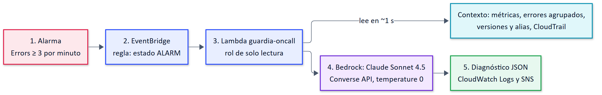
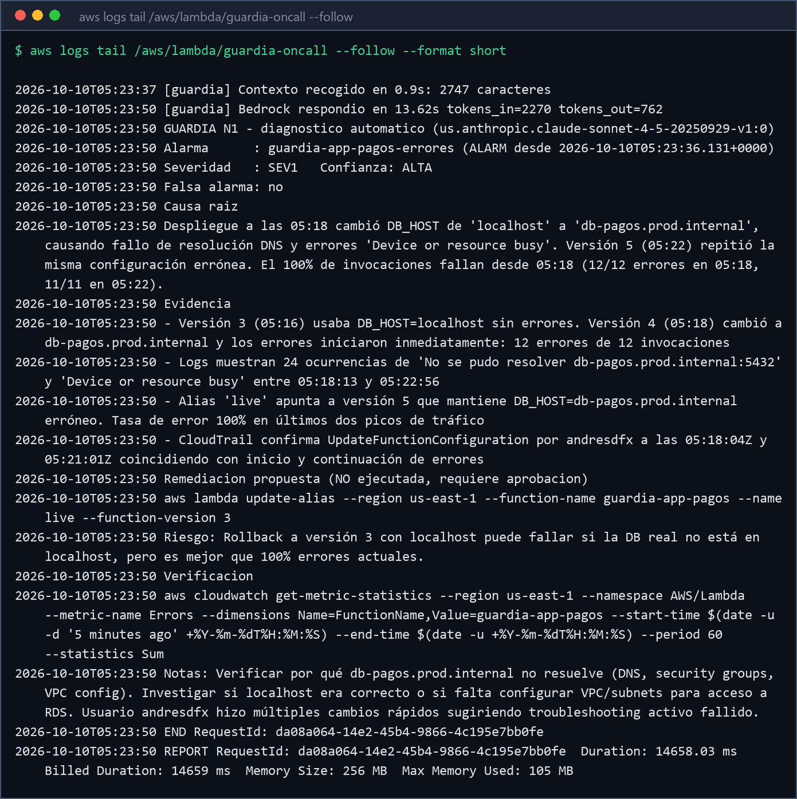

# Guardia N1: tu propio ingeniero DevOps de guardia con Amazon Bedrock

Código de la charla **"AIOps en la práctica: Tu propio Ingeniero DevOps con Bedrock y
CloudFormation"**, DevOpsDays Bogotá 2026 · Julián Castaño.

Una alarma de CloudWatch salta, EventBridge la entrega a una Lambda que junta el contexto
(métricas, errores agrupados, versiones y alias, CloudTrail) y se lo pasa a **Claude Sonnet 4.5**
en Amazon Bedrock por la Converse API. Vuelve un JSON con severidad, causa raíz, evidencia y el
**comando exacto** para remediar. El N1 **no ejecuta** nada: su rol es de solo lectura. Propone y
una persona aprueba.



## Qué hay aquí

| Archivo | Qué hace |
|---|---|
| `template.yaml` | CloudFormation: app de demo con alias `live`, alarma, regla de EventBridge, Lambda de guardia, IAM de mínimo privilegio y SNS |
| `lambda_function.py` | Recoge el contexto, llama a Bedrock con el `SYSTEM_PROMPT`, valida el JSON y publica |
| `deploy.sh` | Empaqueta, sube a un bucket temporal y despliega (`EMAIL=tu@correo.com ./deploy.sh` para recibir el correo) |
| `provocar_fallo.sh` | Mal despliegue real: `DB_HOST` inválido, versión nueva, alias `live` y 12 peticiones |
| `simular_alarma.sh` | Fuerza la alarma sin errores reales, para probar la detección de falsas alarmas |
| `ver_diagnostico.sh` | Muestra el último diagnóstico y lo guarda en `salidas/` |
| `restaurar.sh` | Vuelve a la versión estable (Output `StableVersion`) y deja la alarma en OK |
| `destroy.sh` | Borra el stack y el bucket |

## Probarlo

Pensado para **AWS CloudShell en us-east-1** (AWS CLI v2, python3, zip). La cuenta necesita
acceso habilitado a Claude Sonnet 4.5 en Bedrock.

```bash
git clone https://github.com/AndresDFX/aiops-guardia-bedrock.git
cd aiops-guardia-bedrock
export AWS_REGION=us-east-1
chmod +x *.sh

./deploy.sh              # ~2 min 20 s
./provocar_fallo.sh      # la alarma salta en 60-90 s y el diagnóstico llega ~15 s después
./ver_diagnostico.sh
./restaurar.sh
./destroy.sh             # no lo olvides
```

Un diagnóstico real de la verificación está en
[`docs/ejemplo-diagnostico.json`](docs/ejemplo-diagnostico.json):

```json
{
  "severidad": "SEV1",
  "resumen": "Lambda guardia-app-pagos: 100% errores conexión DB tras cambio config 05:18. Clientes sin procesar pagos.",
  "confianza": "ALTA",
  "posible_falsa_alarma": false,
  "comando_remediacion": "aws lambda update-alias --region us-east-1 --function-name guardia-app-pagos --name live --function-version 3"
}
```



## Medido en la verificación (oct-2026)

| Paso | Resultado |
|---|---|
| Alarma de OK a ALARM | 57-86 s |
| Recoger contexto | ~1 s |
| Respuesta de Bedrock | 11-14 s |
| Diagnóstico | SEV1 con el rollback correcto en 3 de 3 corridas |
| Costo | ≈ USD 0,02 por diagnóstico (perfil `us.`: USD 3,30 / 16,50 por millón de tokens) |

## Antes de llevarlo a producción

- Deduplicar alarmas para no pagar un diagnóstico por cada flapping.
- Pedir la salida por tool use en vez de JSON en texto.
- Añadir tus runbooks como contexto y medir cuántos diagnósticos acierta.
- Mantener la aprobación humana: el modelo se equivoca a veces y el comando lo ejecuta una persona.

Julián Castaño · [linkedin.com/in/andresdfx](https://linkedin.com/in/andresdfx)
